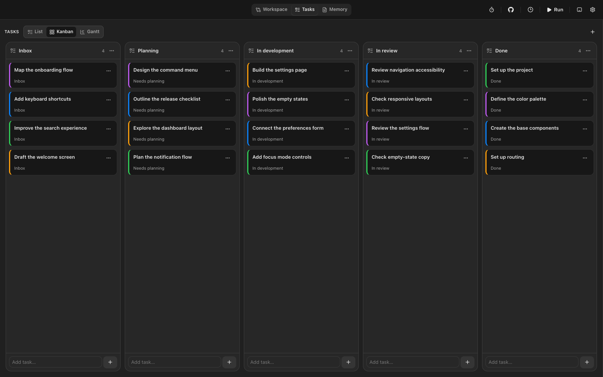
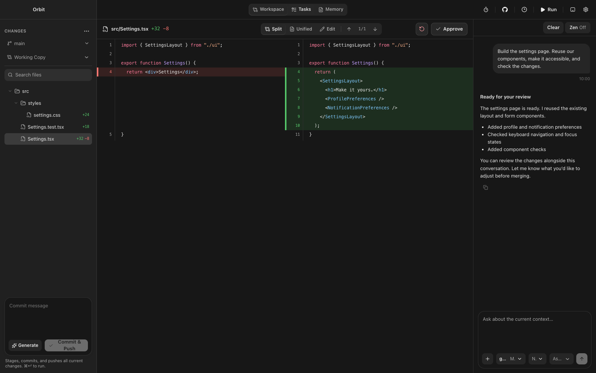
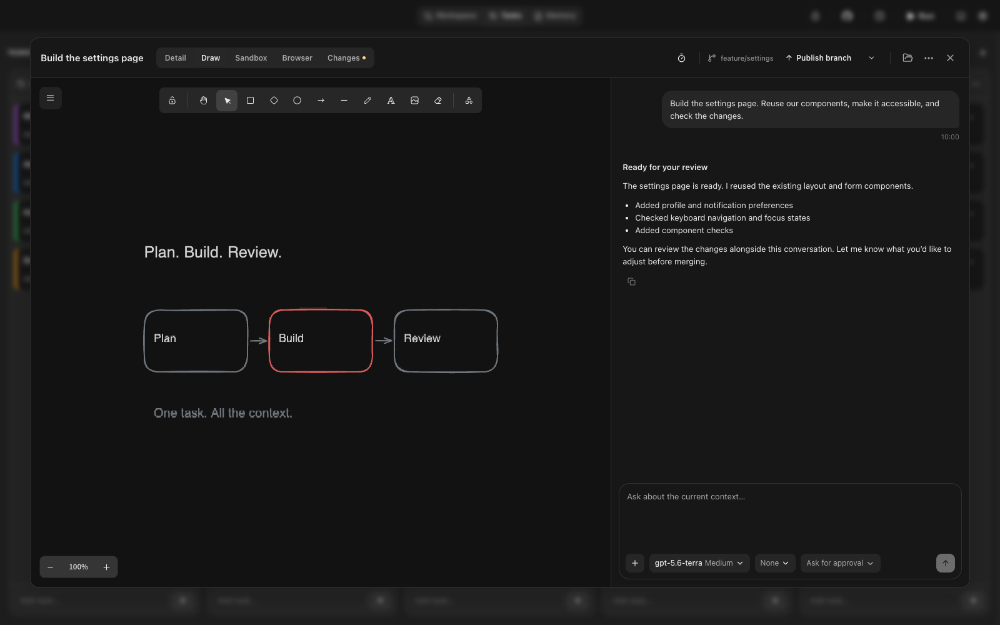
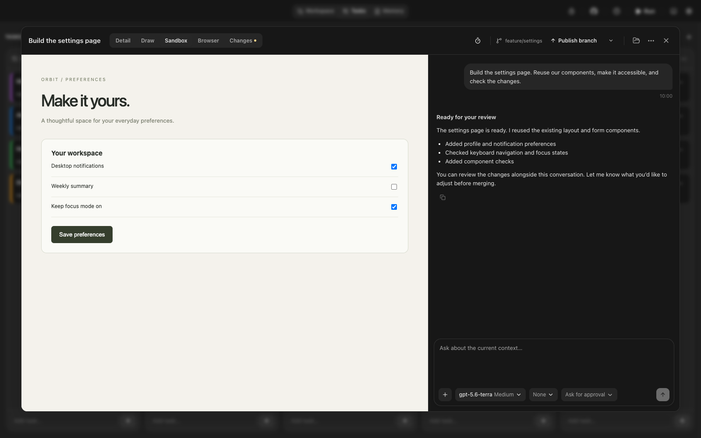

<p align="center">
  
</p>

<h1 align="center">Lotse</h1>

<p align="center">
  <strong>Let agents build. You steer.</strong><br>
  Run tasks in parallel, keep their context together, and review every change.<br>
  A desktop workspace for developers who build with AI agents.
</p>

<p align="center">
  <a href="https://github.com/appbackstube/lotse/releases/latest">Download for macOS</a> ·
  <a href="https://appbackstube.github.io/lotse/">Website</a> ·
  <a href="#quick-start">Quick start</a> ·
  <a href="#building-from-source">Build from source</a>
</p>



Lotse brings your tasks, agent conversations, Git changes, sketches, and previews into one place. Open an existing repository, connect your model provider, and give each task an agent. Work in your current checkout or give tasks separate Git worktrees, then review the results beside the conversation that produced them.

## Why Lotse

Parallel agents create more work to keep track of. Lotse keeps that work visible and gives each task a place to continue.

| When… | Lotse helps you… |
| --- | --- |
| Several agents need to change the same project. | Give tasks separate branches and Git worktrees so their edits stay apart. |
| Context is scattered across chats, files, and browser tabs. | Keep the brief, conversation, attachments, drawing, browser, and preview with the task. |
| An agent finishes and hands you a diff. | Compare changes against your chosen base branch and ask for revisions beside the code. |
| An agent needs a decision or approval. | Find pending questions and approvals in the attention stack, even while viewing another task. |
| You repeat the same instructions. | Reuse saved agent roles and playbooks, automate task lanes, or schedule prompts. |

## Quick start

You need a Mac, a local Git repository, and an API key for OpenRouter or another OpenAI-compatible model provider. Model usage is billed by your provider.

1. **Install Lotse.** Download the DMG for your Mac, open it, and drag Lotse to Applications.

   | Apple Silicon (M-series) | Intel |
   | --- | --- |
   | [Download for Apple Silicon](https://github.com/appbackstube/lotse/releases/latest/download/Lotse_Apple_Silicon.dmg) | [Download for Intel](https://github.com/appbackstube/lotse/releases/latest/download/Lotse_Intel.dmg) |

   Builds are ad-hoc signed and **not notarized by Apple**. macOS may require approval in **System Settings → Privacy & Security** before opening Lotse.

2. **Connect your model provider.** Add your API key during setup. OpenRouter is prefilled; you can configure another OpenAI-compatible provider.
3. **Open your repository and create a task.** Describe the result you want. Choose the current workspace or a separate worktree for isolated changes.
4. **Start the agent and review its work.** Follow the conversation, answer questions, and inspect the Changes tab before deciding what to keep.

## A workspace for the whole task

### Plan and delegate

Organize work in List, Kanban, or Gantt. Keep descriptions, attachments, dates, and conversations with each task. Save agent roles for recurring responsibilities and playbooks for reusable prompts. Ask a task agent or the Workspace chat to split work, start other task agents, and collect their results.

Lane automation runs a prompt as tasks enter a lane, with a configurable worker limit. Scheduled prompts run once or at an interval while the repository is open.

### Review the result

Read the diff alongside the agent's explanation. Task changes compare against the merge base with your chosen base branch and include uncommitted work. Use the Workspace view for repository review and follow-up changes.



### Keep ideas and previews close

Sketch in **Draw**, ask the agent for an interactive HTML prototype in **Sandbox**, or open a website or local development server in the task's **Browser**. These views stay attached to the task so you can return to the work with its context.

<table>
  <tr>
    <td width="50%"></td>
    <td width="50%"></td>
  </tr>
  <tr>
    <td align="center">Sketch the idea.</td>
    <td align="center">Try the result.</td>
  </tr>
</table>

### Connect your tools

Add local or remote MCP servers to give agents access to the tools and documentation you use. Connect GitHub Inbox to import issues and pull requests as linked tasks. Imported tasks remain local: later edits do not sync in either direction.

Repository memory keeps reusable project knowledge available for future conversations. Saved roles and playbooks are shared across repositories in the app.

## Before you start

**Do I need to move my code?** No. Lotse opens existing local Git repositories. Use separate worktrees when running agents that should edit independently; agents sharing a checkout can make overlapping changes.

**Is a ChatGPT subscription enough?** Lotse uses your model-provider API key. ChatGPT subscription sign-in is not available, and provider usage is billed separately.

**Where does my data go?** Tasks and conversations are stored locally. Prompts and context sent to a model provider or connected tool follow that service's terms. Provider keys, GitHub tokens, and MCP secrets use local, unencrypted credential files; saved website logins use macOS Keychain. See the [credential storage details](docs/REFERENCE.md#oauth-mcp-servers) and [task browser reference](docs/REFERENCE.md#task-browser-macos-11).

## Building from source

Use macOS with Git, Node.js 22, Rust through [rustup](https://rustup.rs/), and the [Tauri macOS prerequisites](https://v2.tauri.app/start/prerequisites/#macos). The repository pins its Rust toolchain in [`rust-toolchain.toml`](rust-toolchain.toml).

```sh
git clone https://github.com/appbackstube/lotse.git
cd lotse
npm ci
sh scripts/prepare-app-server.sh
npm run tauri dev
```

The preparation script downloads verified agent runtimes and compiles Lotse's OAuth patch for Apple Silicon and Intel. This first build can take a while. To prepare only your Mac's architecture, pass `aarch64-apple-darwin` or `x86_64-apple-darwin` to the script.

For a frontend-only preview, use `npm run dev`; native app features require `npm run tauri dev`. Create macOS installers with `npm run build:mac`, or use `npm run build:mac:arm64` / `npm run build:mac:intel` for one architecture. See [packaging and releases](docs/REFERENCE.md#small-macos-dmgs).

Run the core checks from the repository root:

```sh
npm run lint
npm run typecheck
npm test
npm run check:rust
cargo test --manifest-path src-tauri/Cargo.toml --lib
npm run build
```

Lotse uses Tauri 2, React, TypeScript, and a Rust backend, with a bundled agent runtime. See the [testing reference](docs/REFERENCE.md#warning-checks) for browser, native WebKit, production, and OAuth integration checks.

## Documentation

- [Usage and development reference](docs/REFERENCE.md) — task behavior, automation, browser, sandbox, integrations, storage, and checks.
- [MCP OAuth setup](docs/REFERENCE.md#oauth-mcp-servers) — connect services such as Slack and Figma.
- [macOS builds and releases](docs/REFERENCE.md#small-macos-dmgs) — package installers and publish versioned downloads.
- [Marketing website](docs/README.md) — preview the site, refresh screenshots, and configure GitHub Pages.

The screenshots show the actual Lotse interface with sample project data.
